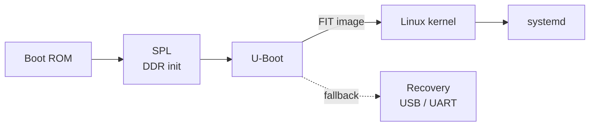
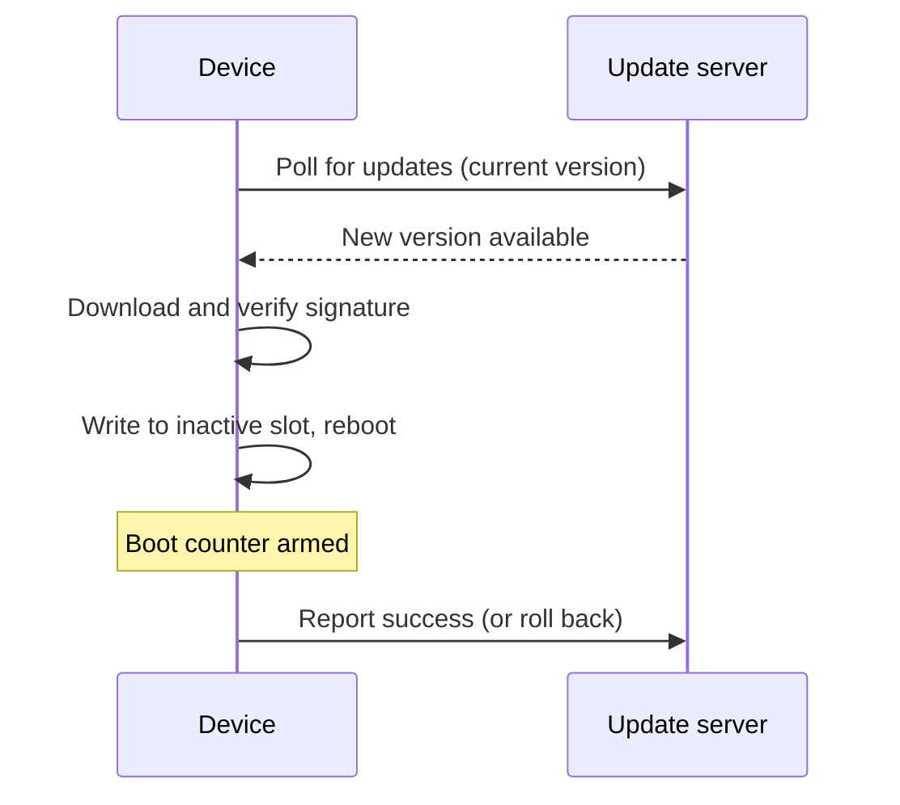

import Figure from '../../components/mdx/Figure.astro';
import Diagram from '../../components/mdx/Diagram.astro';
import Video from '../../components/mdx/Video.astro';
import YouTube from '../../components/mdx/YouTube.astro';
import Callout from '../../components/mdx/Callout.astro';
import devBoard from '../../assets/blog/media-showcase/dev-board.png';
import I2cTiming from '../../assets/blog/media-showcase/i2c-timing.svg';

The first power-on of a new board is always the same mix of excitement and dread. This post
is a placeholder to show how pictures, diagrams and video look here. Replace it with a real
story when you have one.

<Figure src={devBoard} alt="Top view of a green development board with SoC, RAM, eMMC, PMIC and a pin header" caption="Rev B on the bench. Click the image to open it full size." wide />

## Power first, then clocks

Before touching software, check the rails. The PMIC sequences them, and if one is late the SoC
won't even start its boot ROM.

<Callout type="warning" title="Before first power-on">
Use a current-limited bench supply. A dead short on a 1.8 V rail looks exactly like a board
that "just doesn't boot".
</Callout>

## Talking to the PMIC over I²C

The PMIC lives at address `0x50`. A write transaction starts with this on the wire:

<Diagram caption="I²C write to 0x50: START, 7 address bits, R/W = 0, ACK from the target, STOP." wide>
  <I2cTiming />
</Diagram>

That diagram is an inline SVG, so it follows the site's light and dark theme. Draw it in any
tool, export it as SVG, and import it as a component.

## The boot chain

Diagrams can also be plain text. Write a `mermaid` code block and it renders in the browser,
in the site's colors:

Sequence diagrams work too, which is great for describing update flows:

## Scope captures

A real video, with controls. Here it's two sine waves in X/Y mode, the classic Lissajous figure:

<Video
  src="/blog/media-showcase/lissajous.mp4"
  poster="/blog/media-showcase/lissajous-poster.jpg"
  caption="30 Hz on X, 40.05 Hz on Y. The 0.05 Hz offset makes it slowly rotate."
/>

For short animations, use a looping muted video instead of a GIF. It's far smaller (this clip
is 111 KB as MP4 or 117 KB as WebM, against 462 KB for the half-size GIF below) and stays sharp. It plays only while visible, and click to pause:

<Video
  gif
  src="/blog/media-showcase/scope-loop.mp4"
  webm="/blog/media-showcase/scope-loop.webm"
  caption="GIF-style loop: autoplay, muted, no controls."
/>

A real GIF still works when you need one, for example a screen recording from a tool that only
exports GIF:

## Talks and videos from elsewhere

YouTube embeds load nothing from YouTube until you click play:

<YouTube id="aqz-KE-bpKQ" title="Big Buck Bunny (placeholder video)" caption="Placeholder: swap in any video ID." />

<Callout type="tip">
Plain Markdown images work too: ``. Use `<Figure>` when you want a caption,
a wide layout or click-to-zoom.
</Callout>
