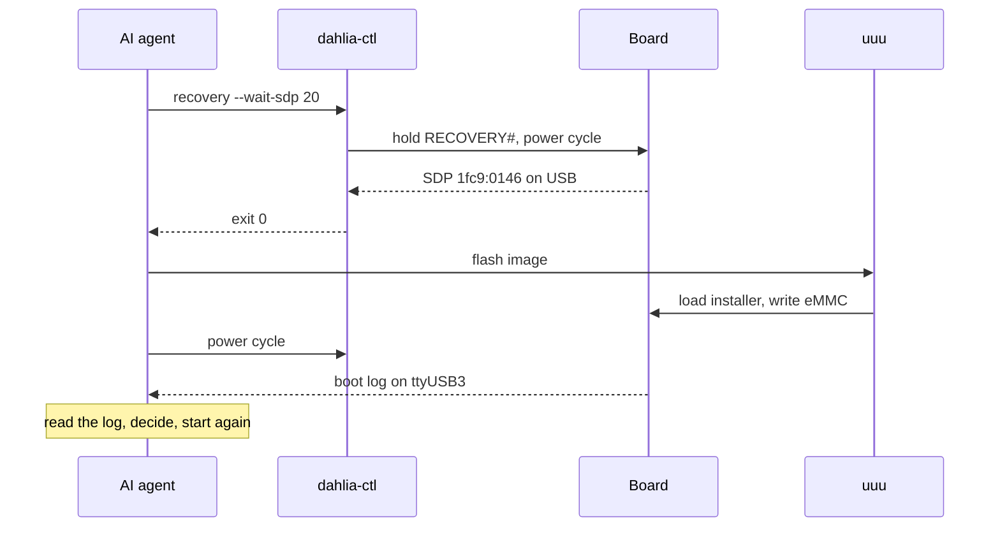

import Figure from '../../components/mdx/Figure.astro';
import Diagram from '../../components/mdx/Diagram.astro';
import Callout from '../../components/mdx/Callout.astro';
import dahliaTop from '../../assets/blog/hardware-in-the-loop-for-ai-agents/dahlia-top.webp';
import AgentLoop from '../../assets/blog/hardware-in-the-loop-for-ai-agents/agent-loop.svg';
import SystemOverview from '../../assets/blog/hardware-in-the-loop-for-ai-agents/system.svg';
import RecoveryTiming from '../../assets/blog/hardware-in-the-loop-for-ai-agents/recovery-timing.svg';

October 2026: if you don't use AI, you are what we could call a BOOMER of the 21st century.
Sometimes I feel like we are back in the early 19th century, when humanity started to build
machines and to play with electricity. As always, some people rejected it, often without
knowing much about it, and some people embraced it. And as usual, there were fanatics on both
sides. In my opinion fanaticism is always wrong, no matter which side you are on. (Fanaticism
is good only when we talk about Italian food 🙂, and the one talking is an Italian.)

Having said that, I think I'm part of a minority in the middle. Many people are too polarized:
they love AI or they hate it. I'm just genuinely curious about new technology, and about how it
can improve the daily work of my whole R&D group, the one I lead, and my own.
AI is without any doubt one of the biggest steps forward in our field in years. It would be
just stupid to ignore it. This is why I decided to dive deep into the topic, and I landed on
the one I'll try to explain in this article.

In a typical R&D group that works on embedded systems, you deal every day with bootloaders,
kernels and software that run on real hardware. Every time you want to test a fix, you need to
reflash, power the board off and on, or put it in recovery mode. This doesn't fit very well
with the rhythm of an AI agent. If you are developing a desktop or web application, a modern
AI agent can easily build a software loop: it looks at the error, writes a fix, tests it, and
does it again until it has a candidate solution. Doing this in embedded is really hard,
because there is a physical device in the middle.

## The loop

Every task on a board follows the same cycle: edit, build, flash, boot, observe, and again.
An agent can do most of these steps from a shell. Flash and boot are the exception, because
someone has to cut the power, hold the recovery strap or press a button.

<Diagram caption="The development loop. The two orange steps need physical access. These are the steps to turn into commands." wide>
  <AgentLoop />
</Diagram>

This idea isn't really new. Modern automated pipelines with hardware in the loop have setups
exactly like this one, with relays, smart power switches, and frameworks like LAVA or labgrid.
But my goal was to have something smaller and simpler, on my desk. And the board already had
the hardware for it.

## The hardware on the board

The [Toradex Dahlia](https://www.toradex.com/products/carrier-board/dahlia-carrier-board-kit)
carrier board has a USB-C debug port (X18) with an FT4232HL quad USB bridge (IC33). Two
channels are UART consoles and one is JTAG. The fourth channel drives four GPIOs. They go
through a level shifter to the power controller and to the reset and recovery lines of the
module. Three of these lines are the same signals as the ON/OFF, RESET and RECOVERY buttons
on the board.

<Figure src={dahliaTop} alt="Top view of the Dahlia carrier board V1.1 with labels on the ON/OFF, RESET and RECOVERY buttons, the X18 USB debug port, the X3 USB OTG port, the FT4232HL chip IC33, and jumpers JP7 and JP3" caption="Dahlia V1.1, top view. Photo: Toradex, labels added by me." wide />

The datasheet, schematics and assembly drawings are on the
[Toradex developer page](https://developer.toradex.com/hardware/verdin-som-family/carrier-boards/dahlia-carrier-board/).
If you want to try this yourself, you can
[buy the board from Toradex](https://www.toradex.com/products/carrier-board/dahlia-carrier-board-kit#buynow).

<Diagram caption="One USB-C cable carries the control lines and the consoles. In recovery mode the SoC appears on the USB OTG port of the module." wide>
  <SystemOverview />
</Diagram>

The problem is the documentation. Toradex does not say which FTDI bit drives which signal.
This is why I did this work, and I will contribute it back to Toradex. A documentation page
about it should be available soon.

## Finding the bits

Finding which FTDI bit drives which signal was not smart work. The agent read the schematics
and found the right channel, then it brute-forced the bus: it drove one bit low at a time and
watched what the board did, on the Linux console and on USB. This kind of work is boring,
repetitive and long to do by hand, and writing a small program for it takes time too. Here
the AI agent really sped up the work, a lot.

| Bit | Signal | What the board did |
| --- | --- | --- |
| 4 | `FORCE_OFF#` | Power off at once, no shutdown, stays off |
| 5 | `RESET#` | Reboot, new kernel boot |
| 6 | `PWR_BTN#` | If on: clean systemd shutdown. If off: power on |
| 7 | `RECOVERY#` | Nothing, unless held during power-on |

<Callout type="tip" title="Ask the agent to keep a log">
The agent wrote every step in a log file: the idea, the command, the result. Because of this
log I could trust the result. Later the log became most of the documentation of the tool.
</Callout>

I reviewed all the code, and I checked the results on the board before I trusted them. A tool
that can cut the power of a board needs a human in the loop while you build it.

## Timing

Finding the mapping took one afternoon. Making it reliable took longer:

- **`RESET#` pulses shorter than ~20&nbsp;ms do nothing.** An RC filter on the reset line
  removes them. The tool uses 150&nbsp;ms.
- **Recovery with a warm reset worked only 1 time in 5.** The SoC reads the boot strap
  reliably only at a cold power-on. So to enter recovery, the tool does a full power cycle and
  holds `RECOVERY#` low the whole time.
- **A quick off and on sometimes stopped DDR training** in SPL. Waiting ~6&nbsp;s between off
  and on fixed it.

<Diagram caption="Entering recovery (not to scale). RECOVERY# stays low during the whole power cycle. The tool releases it only after the cold power-on reset has read it." wide>
  <RecoveryTiming />
</Diagram>

The code follows the diagram step by step:

```c title="c/dahlia-ctl.c" {5-9}
static int act_enter_recovery(double discharge, double hold) {
    if (discharge <= 0) discharge = T_DISCHARGE;
    if (hold <= 0)      hold = T_REC_HOLD;
    int e = 0;
    e |= drive(M_RECOVERY);                 nsleep(T_REC_PRE);
    e |= drive(M_RECOVERY | M_FORCE_OFF);   nsleep(T_FORCE_OFF);
    e |= drive(M_RECOVERY);                 nsleep(discharge);
    e |= drive(M_RECOVERY | M_PWR_BTN);     nsleep(T_PWR_BTN);
    e |= drive(M_RECOVERY);                 nsleep(hold);
    e |= release_all();
    return e;
}
```

To assert a line, the tool sets only that bit as an output and drives it to 0. To release it,
the tool sets the bit back to input, and the pull-up on the board brings it high. When the
program exits, also on `SIGINT` or `SIGTERM`, it releases all lines. So the board never stays
off or in recovery because a command was killed.

## A CLI for an agent

`dahlia-ctl` is a small C program. The first tests used Python and pyftdi, but the final tool
uses libftdi1 and libusb directly. The result is one binary that needs only two libraries at
runtime, `libftdi1-2` and `libusb-1.0-0`. It is packaged as a `.deb` for amd64 and arm64 hosts,
with a man page and a udev rule, so a normal user can run it without root.

An agent can't see the board, so the tool must tell it clearly what happened. It follows three
simple rules:

- exit codes have a meaning: `4` means the command ran but the board did not reach the
  expected state, for example the SoC download device never appeared;
- every command supports `--json`, so the agent can parse the output;
- commands check their result: `recovery --wait-sdp` returns success only when the SoC is
  really on the USB bus.

```bash title="reflash.sh"
sudo dahlia-ctl recovery --wait-sdp 20   # exit 4 if no SoC
sudo uuu <image-dir>/flash.uuu           # flash the eMMC
sudo dahlia-ctl power cycle              # normal boot
```

This is a full reflash, as the agent does it:



## What I learned

What did I learn from this journey, and what did I get out of it?

First of all, AI can really speed up the work, massively, when it involves reading big
documents like manuals, or finding the right bits and how they behave. It would be just stupid
to do this by hand when you have such a powerful tool that can do it for you. For me it doesn't
feel like "someone is doing my job". It feels more like using a calculator for some math: I
don't see any value in doing this stuff manually when there is a tool you can't beat at it. You
just use it. The important thing, as I said before, is to always keep a human in the loop.

The cool part is that I turned an already good carrier board for development into a perfect
agent-ready tool for embedded software development. Now, when a task needs to reflash the
board, I just tell my agent: "use `dahlia-ctl`, restart and reflash the board on your own when
you are ready, and capture the results from the serial console."

<Callout type="warning" title="Check your board revision">
I tested the mapping only on Dahlia V1.1A with a Verdin iMX8M Plus. The FTDI pin assignment
changed between board revisions. Also, JP7 must be closed and JP3 open, or the commands do
nothing and give no error.
</Callout>

All the code is in my GitHub repository,
[EstebanSannin/dahlia-ctl](https://github.com/EstebanSannin/dahlia-ctl), and there is a ready
[`.deb` release](https://github.com/EstebanSannin/dahlia-ctl/releases) that you can try on
your amd64 or arm64 system. I also collected more details in
[DAHLIA-BOARD-CONTROL.md](https://github.com/EstebanSannin/dahlia-ctl/blob/main/DAHLIA-BOARD-CONTROL.md):
the full signal mapping, the jumper settings, the timing measurements, and some open questions.
Lastly, I'm working to get the package into the official Debian and Ubuntu archives, but this
is a long process and it will take some time.
